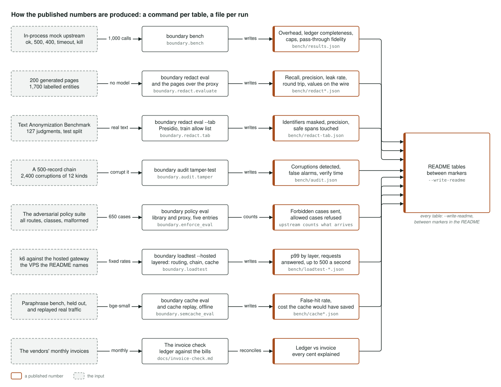

# Architecture

Four figures, one per mechanism: the gateway as a whole, one request's path through the
proxy, the audit chain with its daily anchor, and how each published number is produced.
Each names the module that implements what it shows; [PLAN.md](../PLAN.md) says why, and
[explained.md](explained.md) says the same in plain language.

## The system

Two kinds of caller reach one `Gateway`. Portfolio projects import the library
(`boundary.gateway`) and call it; OpenAI-compatible clients, and anyone with the published demo
key, call the proxy (`boundary.server`) over HTTPS with a team key and an `X-Data-Class`
header, and the proxy calls the same `Gateway`, so a call through either writes exactly the
same ledger row. The proxy adds what the library cannot decide on its own: who is calling and
their quotas, what the data is, reversible redaction with a vault of the values a caller sent,
and the semantic cache. The library asks the data policy (`boundary.enforce`, `policy.yaml`)
whether a declared class may go to a route and refuses when it may not, resolves the route
and checks the caps, sends a raw HTTP request through a provider adapter
(`boundary.providers`) with pinned headers and no vendor SDK, and costs the call from the
returned usage and a dated price file (`boundary/prices/`), never a guessed price, into one
ledger row (`boundary.ledger`). The sealer appends completed rows to the audit chain
(`boundary.audit`), a GitHub Action pulls the chain's head into `anchors/gateway.jsonl` every
day, and every project's ledgers are merged into the central ledger behind the dashboard
(`boundary.central`, `web/`).

## One request through the proxy

Caddy terminates TLS and limits the body (`deploy/Caddyfile`); inside Compose the proxy
publishes no port. The request is identified by the hash of its team key in `teams.yaml`
(`boundary.server.teams`), classified by `X-Data-Class`, which fails closed to `personal` when
absent (`boundary.ledger.data_class`), and judged by the data policy, every rule of which fails
closed: a class that may not go to the chosen route is refused and the refusal is recorded on
the ledger. Personal data is redacted into placeholders with the values held in a per-request
vault (`boundary.server.redaction`, `boundary.redact`). The team's limits are checked before
the call from a worst-case estimate: a sliding minute per team in Redis, and daily and monthly
budgets; a request over a limit gets a 429 that names the limit and when it resets. The
semantic cache (`boundary.semcache`, pgvector in Postgres) is consulted for public requests
only and bypassed for personal and sensitive ones. On a miss the library `Gateway` resolves the
route, checks the cap, calls the vendor and writes the costed ledger row, which the sealer
(`boundary audit follow`) appends to the audit chain within 50 ms. The answer is restored with
only the values this caller sent, the design the rejected one (putting every value back)
leaked through, and returned plain or streamed as it arrives.

## The audit chain and the daily anchor

Every call, through the proxy or the library, writes a ledger row holding identifiers, counts,
hashes, the declared class and residency, the price fingerprint and the cost, and never
content. One sealer process (`boundary audit follow`) turns each completed row into a record:
a sequence number with no gaps, the previous record's hash, the body as canonical JSON, and
`record_hash = sha256(prev_hash, body)` (`boundary.audit.chain`). Records are appended to the
audit table in Postgres, where the proxy's role cannot delete and a trigger refuses `UPDATE`,
`DELETE` and `TRUNCATE` even for the owner. `GET /audit/head` serves the last record without a
key; a GitHub Action (`.github/workflows/anchor.yml`) pulls it at 06:17 UTC every day and
commits one line to `anchors/gateway.jsonl`, so the commit history is a timestamp nobody on
the host controls. The host pushes nothing and holds no credential that can write here. The
Action refuses, without committing, when the head moves in a way no honest chain does: the
sequence going backwards, or the same sequence under a different hash. `boundary audit verify
--hosted` checks the chain against the ledger and the anchors; the tamper test
(`boundary audit tamper-test`) corrupts a 500-record chain 2,400 times across twelve kinds and
reports what verification finds, and the six kinds no chain can see after its last anchor are
reported beside the ones it catches.

## How the published numbers are produced

Each README table has one command, one stated input and one stored run. `boundary bench`
measures the library's own overhead, ledger completeness under fault injection, calls past a
spend cap and pass-through byte fidelity against an in-process mock upstream
(`bench/results.json`). `boundary redact eval` scores detection, precision, leak rate and the
round trip on 200 generated pages holding 1,700 labelled entities, with no model so anyone can
rerun it offline, and `--proxy` sends the same pages through the proxy and counts the personal
values that reached the wire (`bench/redact*.json`); `--tab` scores the Text Anonymization
Benchmark's 127 court judgments the way its own script does (`bench/redact-tab.json`).
`boundary audit tamper-test` corrupts a 500-record chain 2,400 times (`bench/audit.json`).
`boundary policy eval` drives every route, the four declared classes, no declaration and
malformed ones through all five entry points against an upstream that counts what reaches it,
for the library and for the proxy. `boundary loadtest --hosted` runs k6 against the hosted
gateway, the VPS the README names, layer by layer (`bench/loadtest-*.json`). `boundary cache
eval` and `cache replay` score the semantic cache offline on a held-out paraphrase bench and on
replayed real traffic (`bench/cache*.json`). The monthly invoice check reconciles the merged
ledgers against the vendors' bills ([invoice-check.md](invoice-check.md)). Every command takes
`--write-readme` and writes its table between markers in the README.
